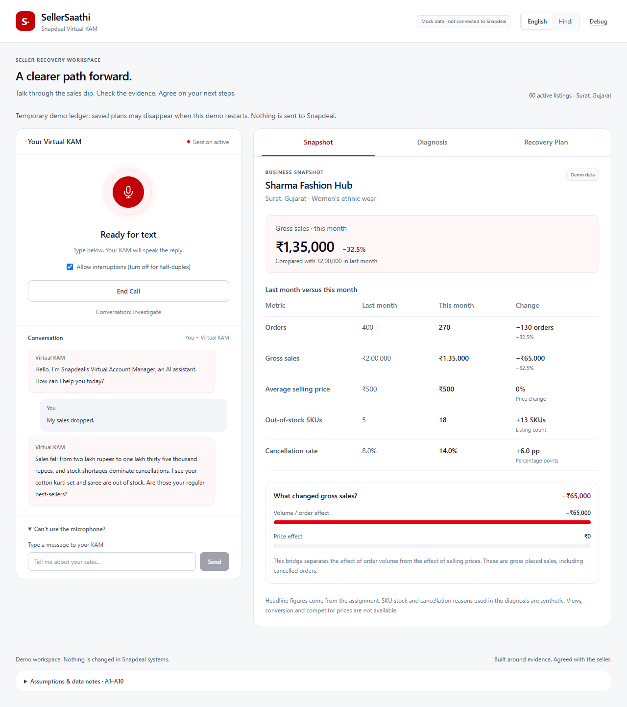
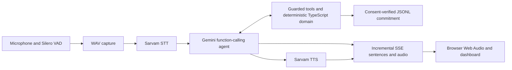

# SellerSaathi — Voice-First AI Virtual Key Account Manager

A voice-first seller recovery assistant that investigates declining sales, identifies operational bottlenecks and builds an actionable recovery plan with explicit seller approval.

**[Open SellerSaathi Live Demo](https://seller-saathi.onrender.com/)**



_Actual application UI captured locally with Playwright, test-only mocked API responses and committed synthetic fixtures. The screenshot illustrates the interface; it does not depict a live provider conversation._

## Overview

When sales fall, a seller needs to understand what changed before deciding what to do. SellerSaathi compares order volume, prices, cancellations and stock availability, explains the evidence, and asks only the questions that can change the recovery plan.

Built for the Snapdeal Mini Virtual KAM assignment, the prototype connects a natural voice conversation to deterministic business analysis and a visible commitment workflow.

## Live demo

Visit **[seller-saathi.onrender.com](https://seller-saathi.onrender.com/)** in Chrome, allow microphone access and click **Call Virtual KAM**. Start with: “My sales have dropped this month.”

The demonstrated workflow is English. The hosted voice conversation has been tested and the submission video recorded by the project author. Render Free may need time to wake after inactivity; this is an evaluation deployment, not production infrastructure.

## Key features

- **Two-way voice:** self-hosted Silero speech detection, Sarvam transcription and sentence-streamed speech playback through Web Audio.
- **Evidence-backed diagnosis:** deterministic sales calculations, stock and cancellation analysis, ranked hypotheses and at most three investigation questions.
- **Practical plans:** two or three eligible seller actions with owners, due dates, success metrics and a seven-day KAM checkpoint.
- **Verified commitment:** explicit acceptance, phase-filtered tools, ownership and eligibility checks, idempotent writes and a bounded JSONL demo ledger.
- **Visible progress:** Snapshot, Diagnosis and Recovery Plan tabs update alongside the conversation; saved state follows successful server-side persistence.
- **Conversation controls:** interruption/barge-in, optional half-duplex mode, text fallback, session limits and usage controls.
- **Illustrative Day-7 review:** audit an accepted plan against synthetic follow-up data; further commitments require fresh consent.

## How it works

1. The seller starts a call and describes the sales decline.
2. The agent retrieves the synthetic seller snapshot, SKU detail and cancellation breakdown.
3. Domain functions calculate changes and rank evidence-backed hypotheses. Gemini coordinates permitted tool calls and the spoken explanation.
4. The agent asks targeted follow-up questions, records the seller's answers and proposes eligible actions.
5. The seller accepts or rejects the proposal. Only verified explicit acceptance permits a commitment.
6. After a successful ledger append, the dashboard shows accepted actions, ownership, dates and the follow-up checkpoint.

## Architecture



One Next.js service owns the server-side orchestration. The LLM handles conversation and tool selection; domain code owns the calculations, question policy and action eligibility. Server guards verify consent and ownership before persistence. Provider adapters sit behind interfaces with offline fakes for tests.

Sessions live in a process-local Map with TTL. Commitments and follow-up audits append to bounded JSONL files. There is no database, vector store, RAG pipeline or multi-agent framework. VAD/ONNX assets are served locally rather than from a runtime CDN.

## Technology stack

| Technology                                | Responsibility                                           |
| ----------------------------------------- | -------------------------------------------------------- |
| Next.js 16.4.6 / React 19.3.1             | Application UI, server routes and standalone service     |
| TypeScript 6.0.3 / Zod 4.6.7              | Strict types and runtime boundary validation             |
| Node.js 22                                | Server runtime                                           |
| Google Gemini / Google GenAI SDK          | Conversation and function calling                        |
| Sarvam AI                                 | Speech-to-text and text-to-speech                        |
| Silero VAD / ONNX Runtime Web / Web Audio | Browser speech detection, capture and playback           |
| Tailwind CSS 4                            | Responsive dashboard styling                             |
| Vitest 5.1 / Playwright 1.65              | Offline domain/integration tests and Chrome verification |
| Docker Compose / Render                   | Local container workflow and hosted demo                 |

Exact dependency versions are pinned in `package-lock.json`. Model and voice profile IDs are environment-configured; validated defaults are in `.env.example`.

## Seller data and demonstration scenario

The assignment's headline comparison is:

| Metric                | Last month | This month |
| --------------------- | ---------- | ---------- |
| Gross sales           | ₹2,00,000  | ₹1,35,000  |
| Orders                | 400        | 270        |
| Cancellation rate     | 8%         | 14%        |
| Average selling price | ₹500       | ₹500       |
| Out-of-stock products | 5          | 18         |

Sales and orders decline by 32.5% while ASP stays flat. The gross sales bridge attributes the ₹65,000 decline to order volume, with zero price effect.

The additional shop identity, SKU-level stock/orders, cancellation reasons and Day-7 fixture are synthetic. In that SKU scenario, three zero-stock listings account for 123 of the 130 lost gross orders (94.6%); stock availability is the leading diagnosis. Impressions, clicks, conversion rates and competitor prices are unavailable and are not invented.

The English S1 path confirms whether the out-of-stock products are regular bestsellers and asks when fresh stock will arrive. Expected actions are priority restocking, matching panel stock to physical stock, and focusing on available bestsellers. Recovery amounts, when shown, are conditional ceilings rather than forecasts.

## Trust, consent and data boundaries

- All seller business data is mock data; this is an assignment prototype.
- There is no connection to Snapdeal internal systems or seller APIs. No real inventory, listing, order or account setting is changed.
- Actions are recommendations. Saving creates a demo commitment record only, after verified explicit seller acceptance.
- The server checks phases, permitted actions, consent evidence and ownership. Failed writes never produce a successful saved confirmation.
- The Day-7 review is illustrative and uses synthetic follow-up data. It preserves the original commitment and requires fresh consent for new actions.
- On Render Free, sessions and the temporary ledger can disappear after idle shutdown, restart or redeployment. Local Compose uses a named ledger volume.

## Run locally

Prerequisites: **Node.js 22.12 or newer within Node 22**, npm 10+, and Chrome for voice use.

```bash
git clone https://github.com/ad8ya089/seller-saathi.git
cd seller-saathi
npm ci
```

Create your private `.env` from `.env.example` without overwriting an existing file. In PowerShell:

```powershell
if (-not (Test-Path .env)) { Copy-Item .env.example .env }
```

On macOS/Linux, use `cp -n .env.example .env`. Privately add the two provider keys described below, then start:

```bash
npm run dev
```

Open **http://localhost:3000/**, click **Call Virtual KAM** and grant microphone permission. If that port is occupied, use the local URL printed by Next.js. Browser microphone access requires localhost or HTTPS. Headphones help avoid speaker feedback. Turning off **Allow interruptions** selects half-duplex capture; **Can't use the microphone?** opens text input.

For a local standalone build, use `npm run build` followed by `npm start`.

### Optional Docker Compose

With Docker Desktop/Engine running and the private `.env` prepared:

```bash
docker compose up --build -d --wait app
```

The default mapping is **127.0.0.1:3000 → container 3000**. `APP_PORT` can select another host port if needed. Compose mounts the named `kamdata` volume at `/data` for local ledger persistence. Render's container port 10000 is a separate hosting setting; it is not the development default.

To stop this local Compose project while keeping its volume:

```bash
docker compose down
```

## Environment variables

| Variable         | Purpose                                                |
| ---------------- | ------------------------------------------------------ |
| `GEMINI_API_KEY` | Required for real conversational model calls           |
| `SARVAM_API_KEY` | Required for real transcription and synthesized speech |

Use the committed `.env.example` defaults for the English model/voice profile and other settings. Keep `.env` private and out of Git. Missing keys allow health checks but do not enable a real call. `/api/health` reports configuration booleans, not provider connectivity.

With both providers configured, the first homepage request can synthesize a cached greeting and six recovery clips before Call. Real conversations and cache warm-up can incur provider charges. Local offline tests use fakes and do not require keys.

## Verification and tests

```bash
npm run lint
npm run typecheck
npm test
npm run verify-data
npm run build
npm run test:browser
```

Run the browser command after the production build; Google Chrome must be installed. Its isolated server uses port 4200, empty provider keys and test-only mocked requests. The suite covers business-data invariants, diagnosis, action eligibility, consent/ownership, idempotency, failed persistence, incremental SSE, cancellation, dashboard states, interruption and synthetic follow-up reviews.

Offline verification is distinct from live provider evaluation and measured production capacity. Live smoke tests, persona evaluations and latency benchmarks are intentionally not part of these commands.

## Project structure

```text
src/app/          Pages, styles and HTTP/SSE routes
src/components/   Voice console and seller dashboard panels
src/lib/agent/    Conversation phases, prompts, tool policy and guards
src/lib/domain/   Pure calculations, diagnosis, questions and action plans
src/lib/llm/      Gemini adapter and test fake
src/lib/voice/    Speech adapters, WAV contracts and audio helpers
src/lib/client/   Browser voice state, VAD and playback
src/lib/server/   Config, sessions, ledger and request orchestration
data/            Assignment metrics and synthetic supporting fixtures
tests/           Unit, integration, browser and diagnostic tooling
scripts/         Verification and local development utilities
docs/            Product, architecture, data and deployment documentation
```

## Current scope and limitations

English is the demonstrated voice workflow. Hindi/Hinglish is disabled in the demonstrated deployment; its existing implementation and tests are outside the demonstrated language scope.

Render Free can sleep after inactivity, and hosted session/ledger data is temporary. Live voice latency and availability depend on Gemini/Sarvam and the hosting environment. Provider usage is charged separately from hosting. The prototype offers synthetic-data recommendations and demo commitments, not production Snapdeal operations.

## Further reading

- [Product and conversation design](docs/02-product-and-conversation-design.md)
- [Architecture and API contracts](docs/03-architecture.md)
- [Data specification and assumptions](docs/05-data-spec.md)
- [Technical decisions](docs/04-tech-decisions.md)
- [Render deployment runbook](docs/12-render-free-runbook.md)
