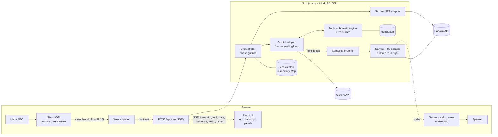
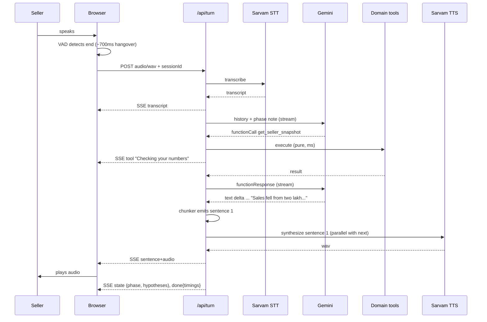

# 03 — Architecture

One Next.js (TypeScript) service, long-lived Node container. No DB, no queue, no vector store, no agent framework.

P4 status: the P3 server path remains unchanged: sessions, real Gemini function calling, seven guarded tools, deterministic phases and JSONL commitments. The browser now uses a typed reducer and a responsive voice console beside Snapshot, Diagnosis and Recovery Plan tabs. Existing session/SSE/confirmation/ledger contracts are preserved. A server-only display projection reads existing domain evidence tables; React does not compute diagnoses or eligibility. Accepted action details and the actual checkpoint date come from the ledger after server-confirmed commitment. Debug values remain observed or explicitly unavailable. Barge-in, fillers, deployment and Hindi remain later phases. See [P4 report](p4-report.md) and [P3 report](p3-report.md); the diagrams below also contain future design elements.

## 1. Component view



## 2. Turn pipeline (the hard flow)



### Latency budget (end of speech → first audible sound)
| Stage | Target p50 | Notes |
|---|---|---|
| VAD end-of-speech hangover | 600–700 ms | tunable; Indian speakers pause |
| Upload + STT (≤8 s utterance) | 700–1000 ms | REST, ≤30 s limit |
| LLM first sentence (incl. 1 tool round) | 800–1200 ms | thinking minimal; tools are in-process |
| TTS first sentence | 500–800 ms | keep first sentence short |
| **Total** | **≈2.6–3.7 s** | Ceiling 5 s. Filler clip plays at +1.5 s if nothing yet |

Levers in order: shorten first sentence → lower thinking → drop hangover to 550 ms → Sarvam streaming (WS) STT/TTS (documented upgrade path, not v1).

## 3. API contracts

All JSON validated with zod at the boundary. Same-origin only.

### `POST /api/session`
Req: `{ lang: "en-IN" | "hi-IN", mode?: "call" | "followup", planId?: string }`
Res: `{ sessionId, greeting: { text, audioB64, mime: "audio/wav" }, snapshot: SellerSnapshotDTO, config: { maxUtteranceMs: 28000, bargeIn: boolean, maxQuestions: 3 } }`
Greeting audio pre-synthesised at server start per language and cached (instant start, zero cost per call).

### `POST /api/turn` → `text/event-stream`
Req (multipart): `sessionId`, `audio` (wav) **or** JSON `{sessionId, text}`; optional `playedSentences: number` (for interruption).
SSE events (each `event:` + JSON `data:`):

| event | data |
|---|---|
| `transcript` | `{ text, sttMs }` |
| `tool` | `{ name, label }` — UI activity feed ("Checking stock by product…") |
| `sentence` | `{ idx, text }` |
| `audio` | `{ idx, mime, b64 }` — in order, never skipped |
| `state` | `{ phase, questionsAsked, hypotheses[], facts[], plan?, committed? }` |
| `fallback` | `{ kind: "tts"|"stt"|"llm", message }` |
| `error` | `{ code, message, retryable }` |
| `done` | `{ timings: { sttMs, llmFirstMs, ttsFirstMs, totalMs }, turn }` |

### `POST /api/confirm` — UI button path
`{ sessionId, planId, decision: "accept" | "decline" }` → same guard as voice commit (plan must exist). Returns `state`.

### `GET /api/health`
`{ ok, version, uptimeS, providers: { gemini: bool, sarvam: bool }, sessions: n }` (no secrets). Used by compose healthcheck.

### `GET /api/ledger`
Latest 20 committed plans (demo only).

## 4. Session model (server memory, TTL 30 min, Map)

```ts
type Phase = "greeting"|"intake"|"findings"|"investigate"|"recommend"|"confirm"|"commit"|"summary"|"done";
interface Session {
  id: string; createdAt: number; lang: "en-IN"|"hi-IN"; mode: "call"|"followup";
  phase: Phase; turn: number; questionsAsked: QuestionId[];
  facts: Partial<Record<FactId, { value: string|number; quote: string; turn: number }>>;
  toolsCalled: Set<ToolName>;
  hypotheses: HypothesisScore[];            // recomputed by domain engine
  proposedPlan?: { id: string; actions: PlanAction[]; proposedAtTurn: number };
  committedPlan?: CommittedPlan;
  history: GeminiContent[];                 // keep model Content verbatim (incl. thought signatures)
  lastUserText?: string;
  counters: { sttCalls: number; ttsChars: number; llmCalls: number };
}
```
History is trimmed to the last ~12 messages plus a compact facts summary; tool results are summarised after use.

## 5. Tools (Gemini function declarations; executed in-process)

| Tool | Args | Returns | Phase allowed |
|---|---|---|---|
| `get_seller_snapshot` | — | metrics, bridge, signals, hypotheses, suggestedNextQuestion, questionsLeft, readyToRecommend | any ≥ intake |
| `get_sku_breakdown` | `{limit?: 1..10}` | top SKUs w/ orders last/this, stock, OOS flag, concentration stat, `synthetic:true` | ≥ findings |
| `get_cancellation_breakdown` | — | reasons last/this, shares, `synthetic:true` | ≥ findings |
| `get_listing_funnel` | — | `{available:false, reason}` | ≥ findings |
| `record_seller_fact` | `{factId: enum, value: string\|number, quote: string}` | updated hypotheses, suggestedNextQuestion, readyToRecommend | investigate |
| `propose_action_plan` | `{actionIds: string[2..3]}` | filled plan (owner, due, metric, impact ceiling), planId | recommend |
| `commit_action_plan` | `{planId, acceptedActionIds, confirmationQuote}` | planId, followUpDate, checkpoints, ledgerPath | confirm |

Guards (all in code, return `{ok:false, error}` the model can read):
- `propose_action_plan`: ids ⊂ eligible catalog; 2 ≤ n ≤ 3; `readyToRecommend` true; no price action unless `competitor_undercut=yes`.
- `commit_action_plan`: plan exists and `proposedAtTurn < session.turn`; `confirmationQuote` ⊂ `lastUserText` (normalised); affirmative regex/negation check; acceptedActionIds ⊂ plan.
- Rate: tool loop ≤ 4 rounds per turn.

Fact enum: `oos_confirmed(yes|no|partial)`, `restock_cause(supplier_delay|cash_constraint|unaware|other)`, `restock_eta_days(number)`, `dispatch_on_time(yes|no|sometimes)`, `views_dropped(yes|no|unknown)`, `competitor_undercut(yes|no|unknown)`, `can_restock_partial(yes|no)`.

## 6. Provider adapters (`src/lib/voice`, `src/lib/llm`)

**Sarvam STT** — `POST https://api.sarvam.ai/speech-to-text`, multipart (`file`, `model`, `mode`, `language_code`), header `api-subscription-key`. Browser uploads are capped at 28 s, mono PCM16/16 kHz and 1 MiB. Response validates `request_id`, `transcript` and `language_code`. Env: `SARVAM_STT_MODEL` (default `saaras:v4`, v3 supported), `SARVAM_STT_MODE` (default `transcribe`), `SARVAM_STT_LANGUAGE` (default `unknown`). Timeout 6 s, at most one retry on 429/5xx within a 13 s total default deadline; bounded Retry-After honored.

**Sarvam TTS** — `POST https://api.sarvam.ai/text-to-speech`, JSON `{text, model, language_code, speaker, pace, speech_sample_rate:24000, output_audio_codec:"wav"}`. Default `bulbul:v4-flash` / `shubh_enhi_ads`; v3 uses short speaker names. Model/speaker formats must match. Validate exactly one `audios[]` output for one text, decode base64 and validate mono PCM16/24 kHz WAV; never concatenate outputs. Same timeout/retry policy as STT. [Provider notes](provider-notes.md) record current official contracts and successful live calls.

**Gemini** — `@google/genai`. Model `GEMINI_MODEL=gemini-3.5-flash-lite`, fallback `gemini-3.6-flash`. Streaming generate with function declarations. Rules: (1) feed the model's returned `Content` (including any thought-signature parts) back verbatim on tool continuation; (2) thinking set to minimal/low via env (name differs by model — verify in smoke test); (3) `maxOutputTokens` ≈ 300; (4) temperature 0.4. Thinking tokens bill as output.

All adapters implement small interfaces (`SttProvider`, `TtsProvider`, `LlmProvider`) so tests inject fakes and a provider can be swapped (e.g. browser TTS, other LLM).

## 7. Sentence chunker (streaming text → speakable units)
- Buffer deltas; cut on `.`, `?`, `!`, `।` followed by whitespace/end; never on digits like `1.35`.
- Min first chunk 20 chars; if >140 chars without terminator cut at last `,`/`;`/` and `.
- Strip markdown, symbols; expand leftovers (`%`→"percent", `₹`→"rupees").
- TTS runs ≤2 in flight; emit audio strictly in idx order.
- On abort: flush nothing, mark turn `interrupted`.

## 8. Client audio
- `getUserMedia({audio:{echoCancellation:true,noiseSuppression:true,autoGainControl:true,channelCount:1}})`.
- vad-web (Silero v6): start `positiveSpeechThreshold 0.5, negativeSpeechThreshold 0.35, minSpeechMs 250, preSpeechPadMs 300, redemption ≈700 ms` (names per installed version); assets self-hosted in `/public/vad` (copied by postinstall) — no CDN at runtime.
- On `onSpeechEnd(audio)` → WAV 16 kHz mono PCM16 → `/api/turn`. Cap utterance 28 s.
- Playback: Web Audio, schedule buffers back-to-back (`start(nextTime)`), single `AudioContext` unlocked on the Call click.
- **Barge-in:** on `onSpeechStart` while speaking → `stopAll()`, `AbortController.abort()` the SSE, send `playedSentences` with next turn so the server truncates the assistant message in history to what was heard. During playback raise threshold to 0.6 to limit self-echo; toggle to half-duplex (VAD paused while speaking).
- State machine: `idle → listening → processing → speaking → listening`.

## 9. Failure handling matrix

| Failure | User sees/hears | Recovery |
|---|---|---|
| Mic denied | banner + text box; KAM still speaks | text path through same `/api/turn` |
| Empty/low STT | "Sorry, I didn't catch that — could you say it again?" (cached audio) | no history pollution; retry counter ≤2 then suggest text |
| STT 429/5xx | brief "one moment" filler | 1 retry → text fallback hint |
| LLM timeout/5xx | filler → retry on fallback model | after 2 fails: cached apology + stay in phase |
| Malformed tool args | none (model self-corrects from `{ok:false,error}`) | loop cap 4 |
| TTS fail on a sentence | browser TTS speaks it; subtle banner | log + counter |
| SSE drop mid-turn | transcript kept; "Let me try again" | client retries once with same text; server idempotency key per (session, turn) |
| Session expired/unknown | "Let's start a new call" | auto-create session |
| Caps hit (turns/time/daily budget) | polite wrap-up audio | no further provider calls |
| Prompt injection / unsafe commit | normal reply, no save | server guards reject |

Idempotency: `turnId` (client UUID) → server caches last response events for 60 s to avoid double-billing on retries.

## 10. Security & abuse control (public URL, paid APIs)
- Keys only on server (SSM → `.env` 0600 at boot). Nothing sensitive in `NEXT_PUBLIC_*`.
- No access-code wall by default (evaluators shouldn't be blocked). Controls instead: per-IP token bucket (40 turns / 10 min), session cap 25 turns / 10 min, global daily cap `DAILY_TURN_CAP=800` (returns spoken wrap-up + banner), 1 MB audio cap, MIME sniff (RIFF/WAVE), zod everywhere, same-origin check on POSTs. Optional `DEMO_ACCESS_CODE` flips a gate if abused.
- Security headers via Caddy (HSTS, `X-Content-Type-Options`, `Referrer-Policy`, `Permissions-Policy: microphone=(self)`), CSP allowing `'self'`, `wasm-unsafe-eval`/`blob:` for ONNX/worklet.
- Logs: pino JSON; session id, turn, timings, tool names, error codes. `LOG_TRANSCRIPTS=false` default.

## 11. Observability (3 AM view, even for a demo)
Per turn: `sttMs, llmFirstMs, llmTotalMs, ttsFirstMs, firstAudioMs, tools[], phase, tokens{in,out}`. In-memory counters exposed at `/api/health?verbose=1` (localhost only via Caddy block): turns, errors by code, fallbacks, p50/p95 firstAudioMs, estimated cost (₹) per session and today. `?debug=1` overlay shows the same live.

## 12. Repo layout

```
snapdeal-virtual-kam/
  AGENTS.md  README.md  prompt.md  .env.example  Dockerfile  compose.yml
  docs/                       # these files
  data/                       # seller.json skus.json cancellations.json followup_day7.json
  deploy/aws-ec2/             # bootstrap.sh deploy.sh start-caddy.sh compose.prod.yml Caddyfile policy.json
  scripts/                    # smoke-sarvam.ts smoke-gemini.ts verify-data.ts chat-cli.ts bench-latency.ts copy-vad-assets.mjs
  public/vad/                 # generated (postinstall), gitignored
  src/app/                    # page.tsx layout.tsx api/{session,turn,confirm,health,ledger}/route.ts
  src/components/             # VoiceConsole Orb Transcript SnapshotPanel DiagnosisPanel PlanPanel DebugOverlay
  src/lib/domain/             # types metrics bridge signals hypotheses questions actions plan data
  src/lib/agent/              # orchestrator tools declarations phases chunker prompts/
  src/lib/llm/                # gemini.ts fake-llm.ts
  src/lib/voice/              # sarvam-stt.ts sarvam-tts.ts wav.ts
  src/lib/server/             # config session-store rate-limit logger ledger metrics
  src/lib/client/             # useVoiceCall vad audio-queue sse wav-encode
  tests/                      # unit/ integration/ evals/ e2e/
```

## 13. What we deliberately don't build
Telephony, auth, multi-tenant, DB, vector search, multi-agent, native speech-to-speech, real Snapdeal APIs, auto-executed inventory/price changes. Each is in the "what I'd do next" list in `docs/08` with the design hook already present (tool interfaces mirror Snapdeal's seller API verbs).
