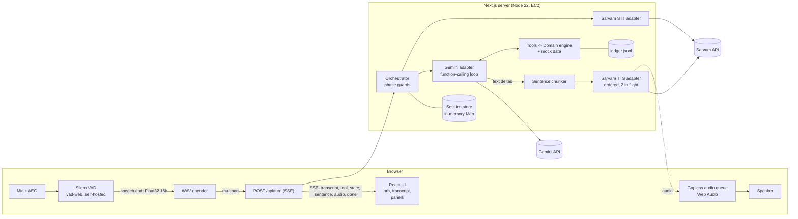
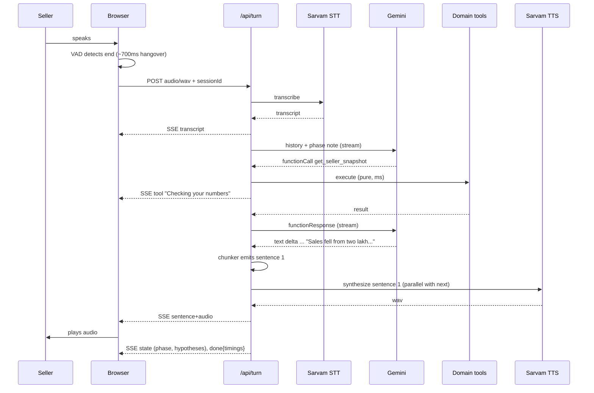

# 03 — Architecture

One Next.js (TypeScript) service, long-lived Node container. No DB, no queue, no vector store, no agent framework.

P5 status: the P4 dashboard and guarded P3 agent remain. Full-duplex interruption with a half-duplex fallback, completed-sentence receipts, interruption-safe consent, cached recovery clips, bounded replay, rate/daily admission, structured metrics and restricted verbose health are implemented. Experimental completed-tool summarization is disabled by default after the S1 simulator pilot failed before saving; raw signed model Content and call IDs remain intact. Real-provider evaluation/benchmark runners require spend confirmation and isolate their ledgers. The user approved pilots only; the full 27-run/20-turn gates and physical device QA remain pending. See [P5 report](p5-report.md). No P6 deployment or Hindi mode was added; diagrams below retain future design elements.

## 1. Component view



## 2. Turn pipeline (the hard flow)



### Latency budget (end of speech → first audible sound)
| Stage | Target p50 | Notes |
|---|---|---|
| VAD end-of-speech hangover | 600–700 ms | tunable; Indian speakers pause |
| Upload + STT (≤8 s utterance) | 700–1000 ms | REST, ≤30 s limit |
| LLM first sentence (incl. 1 tool round) | 800–1200 ms | thinking minimal; tools are in-process |
| TTS first sentence | 500–800 ms | keep first sentence short |
| **Total** | **≈2.6–3.7 s** | Ceiling 5 s. Filler clip plays at +1.5 s if nothing yet |

P5 measured one local HTTP pilot at 13.93 seconds to first response audio; the full twenty-sample 3.7-second p50 / six-second p95 gate is pending. Gemini serial tool rounds/retry dominate. MINIMAL thinking is already configured; VAD redemption remains 700 ms pending physical pause testing. Future experiments must preserve evidence and confirmation guards. See the P5 report for measurement boundaries.

## 3. API contracts

All JSON validated with zod at the boundary. Same-origin only.

### `POST /api/session`
Req: `{ lang: "en-IN" | "hi-IN", mode?: "call" | "followup", planId?: string }`
Res: `{ sessionId, greeting: { text, audioB64, mime: "audio/wav" }, snapshot: SellerSnapshotDTO, config: { maxUtteranceMs: 28000, bargeIn: boolean, maxQuestions: 3 } }`
P5 supports English call mode only; Hindi/follow-up remain future phases. Greeting warming is cached and coalesced, with bounded retry after failure. A cold request may wait or fail; a warm request reuses generated audio without another synthesis charge. Optional access gates and missing provider configuration suppress unauthenticated prewarming.

### `POST /api/turn` → `text/event-stream`
Req (multipart): `sessionId`, `turnId` (UUID), `audio` (wav) **or** JSON `{sessionId, turnId, text}`; optional `playedSentences: integer` in 0..16 counts actually completed response sentences for interruption. Original signed model Content remains intact; heard speech and an interruption marker are separate metadata.
SSE events (each `event:` + JSON `data:`):

| event | data |
|---|---|
| `transcript` | `{ text, sttMs }` |
| `tool` | `{ name, label }` — UI activity feed ("Checking stock by product…") |
| `sentence` | `{ idx, text }` |
| `audio` | `{ idx, mime, b64 }` — in order, never skipped |
| `state` | `{ phase, questionsAsked, hypotheses[], facts[], plan?, committed? }` |
| `fallback` | `{ kind: "tts"|"stt"|"llm", message }` |
| `error` | `{ code, message, retryable }` |
| `done` | `{ timings: { sttMs, llmFirstMs, ttsFirstMs, totalMs }, turn }` |

### `POST /api/confirm` — UI button path
`{ sessionId, planId, decision: "accept" | "decline" }` → same guard as voice commit (plan must exist). Returns `state`.

### `GET /api/health`
`{ ok, version, uptimeS, providers: { gemini: bool, sarvam: bool }, sessions: n }` (no secrets). Provider flags mean configuration, not network connectivity. Compose/proxy deployment is P6. Verbose requires bearer `INTERNAL_METRICS_TOKEN`, including localhost; unauthorized callers get 404.

### P5 read/telemetry endpoints
`GET /api/clips` returns cache readiness and available validated clips (optional access gate). `GET /api/metrics?sessionId=...` returns the latest actual turn report for that session capability. `POST /api/metrics` records a deduplicated filler-play attempt, with origin/access/session validation. These do not add normal conversation turns.

### `GET /api/ledger`
Latest 20 committed plans (demo only).

## 4. Session model (server memory, idle TTL 30 min, Map)

```ts
type Phase = "greeting"|"intake"|"findings"|"investigate"|"recommend"|"confirm"|"commit"|"summary"|"done";
interface Session {
  id: string; createdAt: number; lang: "en-IN"|"hi-IN"; mode: "call"|"followup";
  phase: Phase; turn: number; questionsAsked: QuestionId[];
  facts: Partial<Record<FactId, { value: string|number; quote: string; turn: number }>>;
  toolsCalled: Set<ToolName>;
  hypotheses: HypothesisScore[];            // recomputed by domain engine
  proposedPlan?: { id: string; actions: PlanAction[]; proposedAtTurn: number };
  committedPlan?: CommittedPlan;
  history: GeminiContent[];                 // keep model Content verbatim (incl. thought signatures)
  lastUserText?: string;
  counters: { sttCalls: number; ttsChars: number; llmCalls: number };
}
```
History is trimmed by whole seller turns to about twelve messages, never through a signed tool exchange. Current deterministic facts are supplied in trusted context. Experimental successful/consumed tool-result summaries retain signed model objects and are disabled by default (`COMPACT_TOOL_HISTORY=false`) after the incomplete S1 pilot; see the P5 report. Playback metadata tracks completed speech independently. The original P3 store used age-from-creation for TTL; P5 corrects this to idle activity without changing the separate ten-minute active or 25-turn caps.

## 5. Tools (Gemini function declarations; executed in-process)

| Tool | Args | Returns | Phase allowed |
|---|---|---|---|
| `get_seller_snapshot` | — | metrics, bridge, signals, hypotheses, suggestedNextQuestion, questionsLeft, readyToRecommend | any ≥ intake |
| `get_sku_breakdown` | `{limit?: 1..10}` | top SKUs w/ orders last/this, stock, OOS flag, concentration stat, `synthetic:true` | ≥ findings |
| `get_cancellation_breakdown` | — | reasons last/this, shares, `synthetic:true` | ≥ findings |
| `get_listing_funnel` | — | `{available:false, reason}` | ≥ findings |
| `record_seller_fact` | `{factId: enum, value: string\|number, quote: string}` | updated hypotheses, suggestedNextQuestion, readyToRecommend | investigate |
| `propose_action_plan` | `{actionIds: string[2..3]}` | filled plan (owner, due, metric, impact ceiling), planId | recommend |
| `commit_action_plan` | `{planId, acceptedActionIds, confirmationQuote}` | planId, followUpDate, checkpoints, ledgerPath | confirm |

Guards (all in code, return `{ok:false, error}` the model can read):
- `propose_action_plan`: ids ⊂ eligible catalog; 2 ≤ n ≤ 3; `readyToRecommend` true; no price action unless `competitor_undercut=yes`.
- `commit_action_plan`: plan exists and `proposedAtTurn < session.turn`; `confirmationQuote` ⊂ `lastUserText` (normalised); affirmative regex/negation check; acceptedActionIds ⊂ plan.
- Rate: tool loop ≤ 4 rounds per turn.

Fact enum: `oos_confirmed(yes|no|partial)`, `restock_cause(supplier_delay|cash_constraint|unaware|other)`, `restock_eta_days(number)`, `dispatch_on_time(yes|no|sometimes)`, `views_dropped(yes|no|unknown)`, `competitor_undercut(yes|no|unknown)`, `can_restock_partial(yes|no)`.

## 6. Provider adapters (`src/lib/voice`, `src/lib/llm`)

**Sarvam STT** — `POST https://api.sarvam.ai/speech-to-text`, multipart (`file`, `model`, `mode`, `language_code`), header `api-subscription-key`. Browser uploads are capped at 28 s, mono PCM16/16 kHz and 1 MiB. Response validates `request_id`, `transcript` and `language_code`. Env: `SARVAM_STT_MODEL` (default `saaras:v4`, v3 supported), `SARVAM_STT_MODE` (default `transcribe`), `SARVAM_STT_LANGUAGE` (default `unknown`). Timeout 6 s, at most one retry on 429/5xx within a 13 s total default deadline; bounded Retry-After honored.

**Sarvam TTS** — `POST https://api.sarvam.ai/text-to-speech`, JSON `{text, model, language_code, speaker, pace, speech_sample_rate:24000, output_audio_codec:"wav"}`. Default `bulbul:v4-flash` / `shubh_enhi_ads`; v3 uses short speaker names. Model/speaker formats must match. Validate exactly one `audios[]` output for one text, decode base64 and validate mono PCM16/24 kHz WAV; never concatenate outputs. Same timeout/retry policy as STT. [Provider notes](provider-notes.md) record current official contracts and successful live calls.

**Gemini** — `@google/genai`. Model `GEMINI_MODEL=gemini-3.5-flash-lite`, fallback `gemini-3.6-flash`. Streaming generate with function declarations. Rules: (1) feed the model's returned `Content` (including any thought-signature parts) back verbatim on tool continuation; (2) thinking set to minimal/low via env (name differs by model — verify in smoke test); (3) `maxOutputTokens` ≈ 300; (4) temperature 0.4. Thinking tokens bill as output.

All adapters implement small interfaces (`SttProvider`, `TtsProvider`, `LlmProvider`) so tests inject fakes and a provider can be swapped (e.g. browser TTS, other LLM).

## 7. Sentence chunker (streaming text → speakable units)
- Buffer deltas; cut on `.`, `?`, `!`, `।` followed by whitespace/end; never on digits like `1.35`.
- Min first chunk 20 chars; if >140 chars without terminator cut at last `,`/`;`/` and `.
- Strip markdown, symbols; expand leftovers (`%`→"percent", `₹`→"rupees").
- TTS runs ≤2 in flight; emit audio strictly in idx order.
- On abort: flush nothing, mark turn `interrupted`.

## 8. Client audio
- `getUserMedia({audio:{echoCancellation:true,noiseSuppression:true,autoGainControl:true,channelCount:1}})`.
- vad-web (Silero v6): start `positiveSpeechThreshold 0.5, negativeSpeechThreshold 0.35, minSpeechMs 250, preSpeechPadMs 300, redemption ≈700 ms` (names per installed version); assets self-hosted in `/public/vad` (copied by postinstall) — no CDN at runtime.
- On `onSpeechEnd(audio)` → WAV 16 kHz mono PCM16 → `/api/turn`. Cap utterance 28 s.
- Playback: Web Audio, schedule buffers back-to-back (`start(nextTime)`), single `AudioContext` unlocked on the Call click.
- **Barge-in:** on installed `onSpeechRealStart` (confirmed 250 ms speech) while processing/speaking → `stopAll()`, abort only the active turn, send completed-only `playedSentences` with the next utterance. Heard text is truncated separately from signed Content; an unheard proposal is invalidated and must be presented again before later acceptance. During playback raise threshold to 0.6 to limit self-echo; toggle to half-duplex (VAD paused while speaking).
- State machine: `idle → listening → processing → speaking → listening`.

## 9. Failure handling matrix

| Failure | User sees/hears | Recovery |
|---|---|---|
| Mic denied | banner + text box; KAM still speaks | text path through same `/api/turn` |
| Empty/invalid STT | "Sorry, I didn't catch that — could you say it again?" (cached audio) | no history pollution; retry counter ≤2 then suggest text |
| STT 429/5xx | brief "one moment" filler | 1 retry → text fallback hint |
| LLM timeout/5xx | filler → one primary retry → configured fallback | after bounded attempts: cached/browser apology + unchanged draft phase |
| Malformed tool args | none (model self-corrects from `{ok:false,error}`) | loop cap 4 |
| TTS fail on a sentence | browser TTS speaks it; subtle banner | log + counter |
| SSE drop mid-turn | transcript kept; "Let me try again" | client retries once with same UUID/payload and suppresses delivered replay prefix |
| Session expired/unknown | "Let's start a new call" | offer a new call |
| Caps hit (turns/time/daily budget) | polite wrap-up audio | no further provider calls |
| Prompt injection / unsafe commit | normal reply, no save | server guards reject |

Idempotency: `turnId` (client UUID) → server caches events for 60 seconds within 32 MiB. Fingerprint tombstones reject expired/evicted IDs without provider work; changed content under one ID is rejected. Filler/cached reprompt playback never becomes signed history or response-latency evidence. STT language confidence is not transcript confidence; no unsupported low-confidence threshold is used.

## 10. Security & abuse control (public URL, paid APIs)
- Keys only on server, parsed once in config. Nothing sensitive in `NEXT_PUBLIC_*`. SSM/boot secret provisioning is future P6 work.
- No access-code wall by default (evaluators shouldn't be blocked). Controls instead: per-IP token bucket (40 turns / 10 min), session cap 25 turns / 10 min, global daily cap `DAILY_TURN_CAP=800` (returns spoken wrap-up + banner), 1 MB audio cap, MIME sniff (RIFF/WAVE), zod everywhere, same-origin check on POSTs. Optional `DEMO_ACCESS_CODE` flips a gate if abused. P5 counts accepted attempts before providers, uses Asia/Kolkata midnight reset and keeps the daily counter in memory (restart resets it). Because this route has no authenticated socket peer IP, unverified peers share a conservative bucket; only `TRUSTED_PROXY_TOKEN` allows validated `X-Real-IP` identity. Arbitrary forwarding headers do not select buckets.
- Security headers via Caddy (HSTS, `X-Content-Type-Options`, `Referrer-Policy`, `Permissions-Policy: microphone=(self)`), CSP allowing `'self'`, `wasm-unsafe-eval`/`blob:` for ONNX/worklet.
- Logs: pino JSON; session id, turn, timings, tool names, error codes. `LOG_TRANSCRIPTS=false` default.

## 11. Observability (3 AM view, even for a demo)
Per turn: monotonic `sttMs, llmFirstMs, llmTotalMs, ttsFirstMs, firstAudioMs, totalMs`, tools, phase, actual provider/model IDs, reported input/output/thought tokens, TTS characters, usage completeness, provider retries/fallbacks and interrupted/error status. In-memory verbose counters include accepted/successful/failed/interrupted turns, errors, fallbacks, tokens/characters, filler attempts and successful-audio p50/p95. Lifetime counters reset on restart; latency samples retain the last 4,096 accepted turns, latest reports at most 2,048 sessions. Debug consumes actual per-session reports, with unavailable values explicit.

Pricing is a single validated model-specific table with source/date and USD-per-million-token / INR-per-minute / INR-per-thousand-character units; `PROVIDER_PRICING_JSON` can override it. Combined session/day estimates remain null when failed-attempt usage, model allocation or exchange rate is missing. Never invent an INR conversion. Verbose access requires an explicit internal bearer because Host cannot authenticate localhost. The future P6 Caddy configuration must also block public verbose access; it is not created in P5.

## 12. Repo layout

```
snapdeal-virtual-kam/
  AGENTS.md  README.md  prompt.md  .env.example  Dockerfile  compose.yml
  docs/                       # these files
  data/                       # seller.json skus.json cancellations.json followup_day7.json
  deploy/aws-ec2/             # bootstrap.sh deploy.sh start-caddy.sh compose.prod.yml Caddyfile policy.json
  scripts/                    # smoke-sarvam.ts smoke-gemini.ts verify-data.ts chat-cli.ts bench-latency.ts copy-vad-assets.mjs
  public/vad/                 # generated (postinstall), gitignored
  src/app/                    # page.tsx layout.tsx api/{session,turn,confirm,health,ledger}/route.ts
  src/components/             # VoiceConsole Orb Transcript SnapshotPanel DiagnosisPanel PlanPanel DebugOverlay
  src/lib/domain/             # types metrics bridge signals hypotheses questions actions plan data
  src/lib/agent/              # orchestrator tools declarations phases chunker prompts/
  src/lib/llm/                # gemini.ts fake-llm.ts
  src/lib/voice/              # sarvam-stt.ts sarvam-tts.ts wav.ts
  src/lib/server/             # config session-store rate-limit logger ledger metrics
  src/lib/client/             # useVoiceCall vad audio-queue sse wav-encode
  tests/                      # unit/ integration/ evals/ e2e/
```

## 13. What we deliberately don't build
Telephony, auth, multi-tenant, DB, vector search, multi-agent, native speech-to-speech, real Snapdeal APIs, auto-executed inventory/price changes. Each is in the "what I'd do next" list in `docs/08` with the design hook already present (tool interfaces mirror Snapdeal's seller API verbs).

# P7 implementation addendum

`POST /api/session` accepts `{lang:"en-IN"|"hi-IN", mode:"call"}` or `{lang,mode:"followup",planId,followupRunId?}`. English and call mode remain defaults. A call cannot take parent/run identifiers. A follow-up requires an exact committed record belonging to the current mock seller. Production lookup scans the validated ledger, not only the latest twenty records. Ownership is resolved before greeting synthesis. Hindi admission also requires `HINGLISH_ENABLED=true` after provider verification. Language and mode cannot change when replacing session drafts.

Follow-up responses include `initialState` with a validated `followup` view and the separate uppercase phase. The simulated date is the original commitment's Asia/Kolkata business date plus the fixture window; for a simulated review-plan parent, its explicit simulated date anchors the next review. Actual append timestamps remain real timestamps. The normal SSE envelope and incremental sentence/audio delivery are unchanged.

The review's public state machine is separate from S1. Its internal `Session.phase` is used only as an adapter to reuse the existing proposal/heard/eligibility/acceptance/commit transaction guards. The follow-up orchestrator never calls the S1 investigation policy. `get_followup_status` takes strictly empty arguments, is bound to the session's parent and is exposed only in AUDIT. Only the existing `commit_action_plan` is exposed while an earlier, heard new proposal awaits acceptance. The normal UI confirmation route uses the same guard. Playback receipts invalidate an unheard proposal.

An equal-window adapter supplies baseline daily orders × seven and the actual rolling orders to the existing diagnosis engine. Its derived sales/counts are internal comparison inputs, never new reported metrics. Updated SKU stock retains historical order counts only for priority sorting. Old SKU concentration and old cancellation reasons are excluded. Review-only `S_REMAINING_OOS` and `S_PARTIAL_RESTOCK` table weights (STOCK +2/+1) describe remaining work; they do not change S1 weights or forecast outcomes. The catalog filters completed work and permits unfinished stock sync without fabricating a cancellation-reason share.

Validated audit records append to `DATA_DIR/followup-audits.jsonl`, serialized per file, with plan/run ID, simulated date, actual timestamp, exact seller quote, rows, facts and phase trace. The original plan ledger is never overwritten. Repeated identical writes are idempotent; conflicting payloads or cross-plan run IDs fail closed. Review proposal IDs are `review-<run UUID>`, so resets cannot generate another commitment ID for the same run. A persisted audit restores after in-memory expiry/removal; a completed run returns its existing commitment. An unfinished run must present its proposal again before acceptance. One process/one replica remains required.

Provider adapters select language-specific STT/TTS profiles. Greeting and all six auxiliary clips are isolated by language, model, speaker, pace, sample rate and text/clip identity. All languages share the existing two-slot TTS limiter. Hindi greeting failure returns its text and the existing client fallback event; English greeting failure retains the prior error behavior. Browser Hindi fallback requires an installed Hindi voice. No English-only browser voice is substituted for Hindi.
