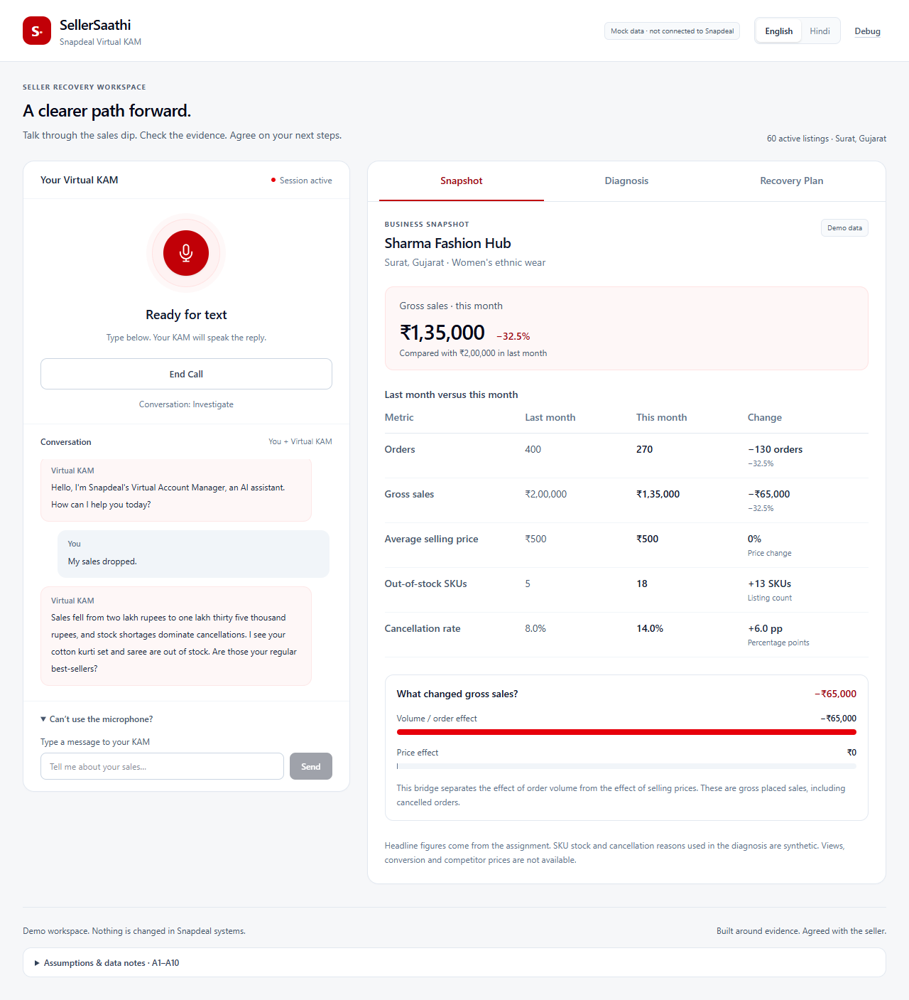
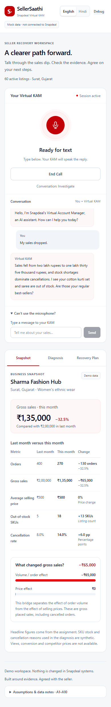

# P4 — SellerSaathi dashboard

Verified locally on 11 November 2026 (Asia/Calcutta), Windows, Node 22.13.1, npm 10.9.2 and Google Chrome 156.0.8078.80. The preserved P3 starting point was clean `main`, thirty-three commits, head `c3d6d89`.

## Implemented UI

The desktop workspace places the voice console on the left and Snapshot, Diagnosis and Recovery Plan tabs on the right at widths of 1024px and above. At 390px the console comes first, followed by the same tabs. The interface uses neutral surfaces, a red accent, local system fonts, CSS-only state animation and visible keyboard focus.

- **Header:** SellerSaathi, Snapdeal Virtual KAM, the mock-data disclosure, active English, disabled Hindi with a focus/hover tooltip and a query-controlled Debug link. No barge-in control is presented.
- **Voice:** the existing greeting/capture/STT/SSE/playback lifecycle is reused. The console shows the call state, server phase, distinct conversation bubbles, tool activity, errors and a collapsible text path. End Call remains available while processing. A server-confirmed completion leaves the plan available for review; a new call clears the previous session data.
- **Snapshot:** server values for orders, gross sales, ASP, out-of-stock count and cancellation rate; previous/current comparison and relevant deltas; the actual gross sales volume/price bridge. Indian grouping is used, including ₹2,00,000 and ₹1,35,000. The bridge's −₹65,000 volume effect and ₹0 price effect come from the backend. Synthetic detail and unavailable funnel/price data are labelled.
- **Diagnosis:** server ranking, scores and confidence; evidence grouped under each hypothesis with Data/Seller said source labels; exact seller quotes; questions used/remaining; current server-spoken question and the tool activity timeline. Scores are displayed as scores, not probabilities. Bar geometry follows the displayed scores rather than an invented confidence percentage.
- **Recovery Plan:** actual action titles, owner, due date, expected stock date, success metric and qualified impact; a separate Virtual KAM checkpoint. The checkpoint displays its own review impact. Confirm Plan/Not Now show pending state and invoke the existing guarded API. Neither a proposal nor a failed request produces a saved status.
- **Footer/debug:** one shared A1–A10 constant, checked against docs/01, in a native collapsible section. Debug appears only with `?debug=1`; missing timings/usage are Not available. No cost is invented from unavailable token usage/pricing.

There are no placeholder business figures before a session starts. Empty/loading/unavailable states explain what the call will populate.

## State and data boundaries

`useVoiceCall` now uses `useReducer`. Optional observer callbacks expose the existing controller's session response, turn boundary, SSE events, errors and confirmation result to the dashboard. Microphone handling, WAV validation, SSE parsing, audio ordering, greeting sequencing and half-duplex pause/resume remain in their P2/P3 responsibilities.

The reducer handles transcript/sentence segments, repeated state, tool events, fallback/error, proposal, confirmation, ledger details, End Call and a new session. Sentence updates are indexed and can replace repeated segments without duplicate bubbles. Optional state/tool events can precede transcript updates. Mandatory audio sequencing remains enforced by the unchanged P3 parser.

An unfinished failed turn restores the last successfully completed server view. Session expiry and provider errors remain actionable; starting another call resets old facts, plan, activity and debug values. Late ledger responses for an older session are ignored. Commitment is sticky within a completed session and is never inferred from phase or plan presence alone.

The existing HTTP and SSE contracts, system prompt, Gemini tools, domain weights, thresholds, eligibility and phase rules were not changed. `dashboard-contracts.ts` validates the fields the UI consumes from the existing session snapshot. A server-only `dashboard-reference.ts` reads the existing domain functions/tables to produce display metadata and deltas. The client uses this metadata only with the matching seller snapshot; it does not import the policy tables or calculate hypothesis scores.

Detailed evidence is revealed after the server phase confirms completed findings. A tool activity label alone is not treated as proof that a check succeeded. Seller evidence comes from the actual recorded facts. Remaining questions are a display difference between server-configured maximum and server-used count; bar dimensions and number/date formatting are presentation arithmetic, not diagnosis rules.

After `committed=true`, the client reads the existing ledger endpoint and matches the plan ID. Only its `acceptedActionIds` are shown as committed, and its actual follow-up date is used. This avoids treating every proposed action or an old proposal date as the saved commitment. If ledger details are unavailable, the confirmed status and unavailable detail are distinguished.

## Component and file inventory

| Area                   | Files                                                                                                                                   |
| ---------------------- | --------------------------------------------------------------------------------------------------------------------------------------- |
| Shell                  | `src/components/SellerDashboard.tsx`, `AppHeader.tsx`, `DashboardTabs.tsx`                                                              |
| Business views         | `SnapshotPanel.tsx`, `DiagnosisPanel.tsx`, `PlanPanel.tsx`, `PlanActionCard.tsx`                                                        |
| Voice/debug/footer     | `VoiceConsole.tsx`, `VoiceDebug.tsx`, `DebugOverlay.tsx`, `AssumptionsFooter.tsx`                                                       |
| Reducer and view types | `src/lib/client/app-state.ts`, `dashboard-contracts.ts`, `dashboard-view.ts`                                                            |
| Shared presentation    | `src/lib/client/format.ts`, `transcript.ts`, `src/lib/content/assumptions.ts`                                                           |
| Server projection      | `src/lib/server/dashboard-reference.ts`                                                                                                 |
| Voice integration      | `useVoiceCall.ts`, `voice-call.ts`, `voice-state.ts`, `turn-playback.ts`, `session-api.ts`                                              |
| Page/style             | `src/app/page.tsx`, `layout.tsx`, `globals.css`                                                                                         |
| Unit/component tests   | `tests/client/{app-state,dashboard-view,format}.test.ts`, `tests/components/{snapshot,panels,assumptions}.test.ts`, shared DTO fixtures |
| Browser tests          | `playwright.config.ts`, `tests/browser/dashboard.spec.ts`, `mock-backend.ts`                                                            |

The only new direct package is **`@playwright/test@1.65.0`**, a development dependency for the requested browser smoke tests. Its two new transitive packages are `playwright` and `playwright-core`. The tests use installed Chrome; no extra UI, state, chart, DOM-test or animation library was added. Lighthouse 12.8.2 was run as a one-off npm CLI package, not added to the application. It supports the installed Node version; the then-current Lighthouse 13.6.0 requires Node 22.19 or later.

## Screenshots and visual verification

These are genuine Chrome captures of the implemented application using synthetic browser-test responses generated from the existing domain fixtures. They demonstrate UI behavior, not live-provider latency or physical microphone quality. Two representative captures are deliberately selected as documentation assets; the other captures and test traces remain ignored under `.tmp/p4/`.

| Capture               | Path                                                 |  Width |
| --------------------- | ---------------------------------------------------- | -----: |
| Desktop Snapshot      | `docs/images/p4-desktop.png`                         | 1280px |
| Mobile Snapshot       | `docs/images/p4-mobile.png`                          |  390px |
| Desktop Diagnosis     | `.tmp/p4/screenshots/desktop-1280-diagnosis.png`     | 1280px |
| Desktop saved plan    | `.tmp/p4/screenshots/desktop-1280-saved-plan.png`    | 1280px |
| Desktop declined plan | `.tmp/p4/screenshots/desktop-1280-declined-plan.png` | 1280px |
| Mobile plan           | `.tmp/p4/screenshots/mobile-390-plan.png`            |  390px |





Screenshots were visually inspected for clipping, overlap, number formatting, misleading success state and stale content. The desktop columns and mobile stacking render correctly. Browser assertions verify no horizontal document overflow at 390px for Snapshot and Recovery Plan. Arrow keys, Home/End tab navigation, focusable Hindi explanation, reduced-motion behavior and the keyboard skip link are exercised. An off-screen-only skip-link technique caused an artifact in full-page screenshots; clipping it while unfocused fixed the capture and retained keyboard visibility.

## Accessibility

Lighthouse **12.8.2** on the standalone application reported:

| Profile        | Accessibility score | Failed scored audits |
| -------------- | ------------------: | -------------------: |
| Desktop preset |         **100/100** |                    0 |
| Mobile preset  |         **100/100** |                    0 |

The initial desktop score was 96/100, with two low-contrast footer lines. Their contrast was corrected before the two successful audits above. Target 90 was met without disabling audits. These audits cover the initial application page; dynamic populated states additionally received the browser/visual/keyboard checks described above. They do not constitute exhaustive screen-reader or physical listening certification.

Local reports: `.tmp/p4/lighthouse-desktop.report.{html,json}` and `.tmp/p4/lighthouse-mobile.report.{html,json}`. The audit server had no provider credentials, so page prewarm made no paid provider call. It was separate from the user's development session.

Reproduction uses installed Chrome, an already-built standalone server on port 4201, `CHROME_PATH` pointing to Chrome, and:

```sh
npm exec --yes --package=lighthouse@12.8.2 -- lighthouse http://127.0.0.1:4201/ --only-categories=accessibility --preset=desktop --chrome-flags="--headless=new" --output=json --output=html --output-path=.tmp/p4/lighthouse-desktop --quiet
```

For the mobile audit the desktop preset flag is omitted. The explicit 1280px/390px captures come from Playwright; Lighthouse uses its own desktop/mobile preset emulation.

## Automated verification

| Command                       | Actual result                                                                               |
| ----------------------------- | ------------------------------------------------------------------------------------------- |
| `npm run lint`                | Exit 0; strict ESLint, zero warnings, Prettier passed                                       |
| `npm run typecheck`           | Exit 0; strict TypeScript                                                                   |
| `npm test`                    | Exit 0; **291 tests in 46 files**                                                           |
| `npm run verify-data`         | Exit 0; **36/36 invariants**                                                                |
| `npm run build`               | Exit 0; data verification, production compilation, TypeScript and page generation succeeded |
| `npm run test:browser`        | Exit 0; **5 Chrome tests**                                                                  |
| `npm audit --omit=dev --json` | Exit 0; zero production vulnerabilities                                                     |

All P1–P3 tests remain, including the P3 275-test baseline. The sixteen additional unit/component tests cover snapshot initialization, transcript segments, tools/rankings/facts, proposals, pending/success/failed confirmation, decline, provider fallback/error, End Call, new-session reset, repeated state, optional timing, rollback, accepted subsets, formatting, data-reference matching, score geometry and documentation assumptions. Mobile rendering is verified in Chrome rather than a simulated DOM library.

The browser suite covers:

1. A fake-provider session/greeting, live Snapshot/Diagnosis/Plan updates, repeated state, delayed confirmation without optimistic success, the confirmed ledger result and new-session reset.
2. Failed confirmation with no saved status, then Not Now/decline with zero writes in the test ledger.
3. 390px stacking, no horizontal overflow, keyboard tabs, reduced motion and keyboard-visible Hindi tooltip.
4. Debug hidden without its query flag and unavailable fields shown honestly.
5. Skip navigation hidden until keyboard focus and focus transfer to the workspace.

Fake HTTP responses and microphone denial exist only in the Playwright runner. The test server receives empty provider keys, and health must report both false. Without interception, its real session route must return the configured-provider error rather than a fake session. There is no app environment switch, public route or production provider branch that enables these mocks. The populated browser test also checks that page requests stay on the local application origin.

The first browser collection needed explicit JSON import attributes in the shared Node fixtures; Vitest and Chrome tests pass with that correction. One late rebuild encountered Windows locking the output directory while temporary standalone servers were still running. Stopping those owned servers before rebuilding resolved it; no checks or build protections were disabled.

## Real P1–P3 integration checks

The existing development service on localhost:3000 served the P4 page with HTTP 200 and valid configured-provider health. A separate production standalone service started on 127.0.0.1:4101. Both returned a valid real session, actual server snapshot and validated 24 kHz greeting WAV. Observed greeting duration was 5.04 seconds in development and 5.36 seconds in production. An initial cold production greeting/session attempt returned 503; a subsequent request recovered through the existing greeting cache's retryable initialization path. Provider error details were not exposed or guessed.

Both environments rejected confirmation without an owned proposal with HTTP 409. Their ledger endpoint returned the real S1 record without exposing a filesystem path. Verification sessions were deleted individually; the user's session was not terminated.

The additional real `npm run chat -- --scenario S1` check initially hit the unchanged eight-second model deadline after partial plan speech. It rolled back to INVESTIGATE and did not commit. A fresh bounded retry of the script succeeded:

- Prompt version 3.0.0, configured primary `gemini-3.5-flash-lite`; twelve successful model invocations, all on that primary in this run.
- Four seller turns, Q_OOS_CONFIRM and Q_RESTOCK_ETA, three eligible actions, DONE.
- Plan `817efd36-a824-4e67-b425-940840e39dfd`; exactly one matching ledger record. Follow-up **2026-11-18**, derived from the injected business date after midnight in India.
- Reported successful usage: 54,617 input tokens, 443 output tokens, zero thought tokens. STT/TTS were not invoked by the CLI.
- Ignored synthetic trace: `.data/chat/S1-1794336006914-941cdf12-cfb8-411d-aa78-6681927e9d08.json`.

The live checks are separate from the automated fake-provider suite. Normal unit, component and browser tests do not call Gemini or Sarvam.

## Baseline, scope and remaining checks

The P3 human Chrome first-audio median remains **11,768 ms, rounded to 11.77 seconds**. Its three reported voice turns were 15,710; 11,768; 10,605 ms. P4 is a UI phase and does not claim a lower voice latency. Model limits, retries, prompt and provider choices were preserved. The extra live timeout and cold greeting failure above are retained as observed operational limits, rather than hidden by test fakes or relaxed deadlines.

The current SSE contract does not provide browser token usage/cost, a turn number on UI-confirm responses or a fresh next-question ID with every state. Debug therefore shows unavailable usage/cost and the last completed SSE turn; the diagnosis uses the server-spoken current question when available. Those contract limitations were handled without adding fields or reimplementing diagnosis rules in React.

A fresh P4 human voice/dashboard check was requested. No explicit result had been received at this report checkpoint. Physical microphone audibility, return-to-Listening observations and human inspection during a real P4 voice conversation remain unconfirmed; the P3 human evidence, unchanged voice lifecycle regressions, real provider/HTTP checks and fake-browser visual checks are identified separately above. No P5 barge-in, latency optimization or evaluation harness was started. No blocking UI implementation question remains.

## Git and secret checks

At the verification checkpoint before committing this report: branch **main**, **40 local commits**, latest implementation/test commit **2a7a10c** (`test: add isolated Chrome dashboard and responsive smoke coverage`). The only pending files are README/architecture/report documentation and the two deliberately selected PNGs. The final documentation commit is additional; its verified hash, total count and clean status are stated in the delivery message so this file does not attempt to contain its own commit hash.

All thirty-three P3 commits are preserved. Seven P4 implementation/test commits precede this documentation commit. No reset, clean, amend, rebase, history rewrite or push was used. Generated build files, temporary audits, other screenshots, traces, audio, runtime ledger and `.env` remain ignored. The two images in `docs/images/` are explicitly selected documentation artifacts made from synthetic test data.

A private comparison against both configured key values found zero occurrences in tracked files, Git patch history or generated browser static assets. Only counts were printed. Browser tests assert local-origin page requests; client requests use the existing application endpoints and do not carry provider credentials. The new server-only projection serializes only its validated display model, never configuration secrets.

Implementation references: [Playwright API interception](https://playwright.dev/docs/mock), [isolated test web server](https://playwright.dev/docs/test-webserver) and [Lighthouse CLI](https://github.com/GoogleChrome/lighthouse#using-the-node-cli).
